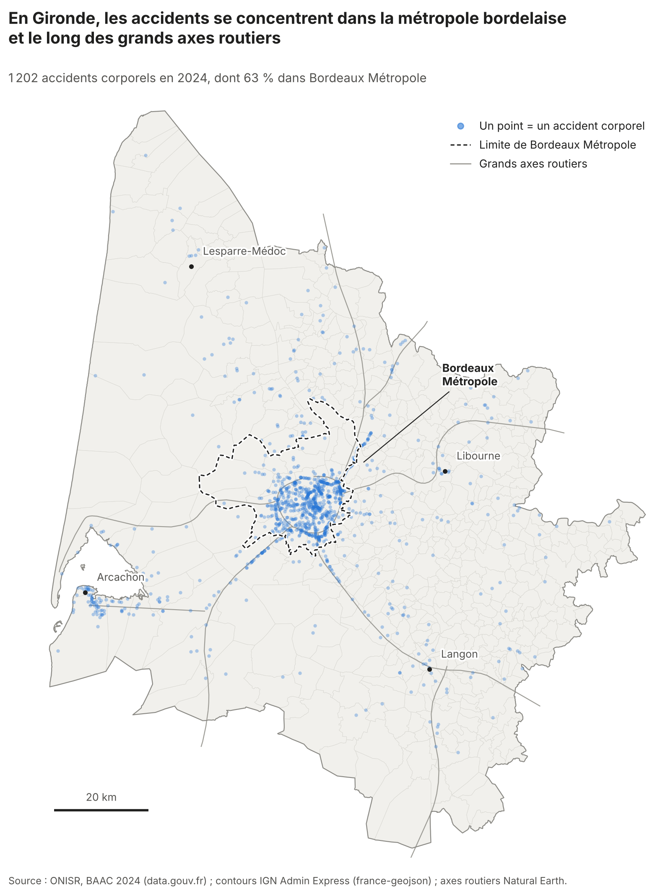
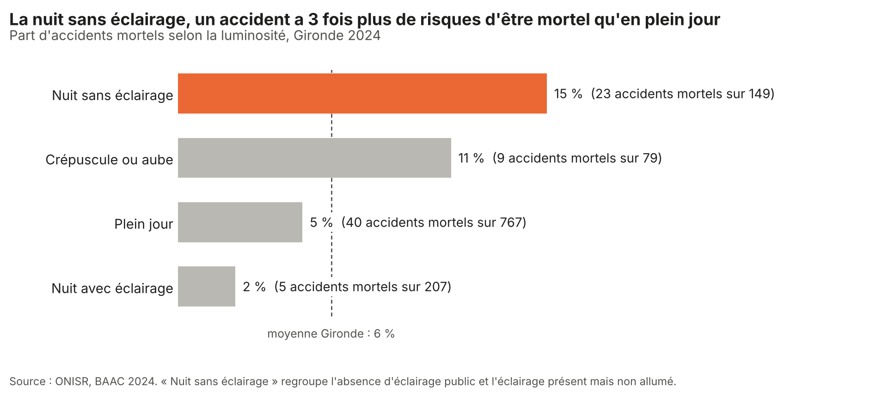

# Accidents corporels de la circulation – Gironde, 2024

Données : ONISR, base BAAC 2024 ([data.gouv.fr](https://www.data.gouv.fr/datasets/bases-de-donnees-annuelles-des-accidents-corporels-de-la-circulation-routiere-annees-de-2005-a-2025)). 

## Interprétation

La Gironde compte 1 202 accidents corporels en 2024, dont 77 mortels (83 tués).

- **Localisation** : Bordeaux Métropole concentre 63 % des accidents mais seulement 30 % des accidents mortels. Hors de la métropole, 12 % des accidents sont mortels, contre 3 % dans la métropole. En ville, les accidents sont fréquents mais à vitesse réduite. Sur le réseau rural, ils sont plus rares mais plus graves : les routes départementales comptent 19 % des accidents et 43 % des accidents mortels.
- **Luminosité** : la nuit sans éclairage public représente 12 % des accidents, mais 15 % de ces accidents sont mortels. Ce taux est de 5 % en plein jour et de 2 % la nuit sur une voie éclairée. On observe la même hiérarchie à l'échelle nationale. Une partie de l'effet tient aussi au lieu : 74 % de ces accidents ont lieu hors agglomération.
- **Limites** : avec 77 accidents mortels sur une seule année, les taux restent fragiles. Sans données de trafic, on compare la gravité des accidents, pas le risque d'en avoir un.

## Choix graphiques

- **Carte** :
  - grille hexagonale de 4 km plutôt que 1 202 points superposés (règle 13) ;
  - légende en 5 classes à bornes entières, dans une seule teinte de bleu (règles 8 et 14) ;
  - accidents mortels en points orange cerclés de blanc, posés sur la même carte ;
  - villes et limite de la métropole nommées directement sur la carte (règle 9).
- **Luminosité** :
  - 5 codes regroupés en 4 catégories (règle 11) ;
  - barres horizontales (règle 7) triées par part d'accidents mortels (règle 12) ;
  - une seule couleur d'accent, avec les valeurs écrites au bout des barres (règle 9) ;
  - pourcentages entiers accompagnés des effectifs (règle 14).
- **Partout** : pas de cadre, d'ombre ni de grille superflue (règle 10), et un titre qui énonce le résultat (règle 16).
