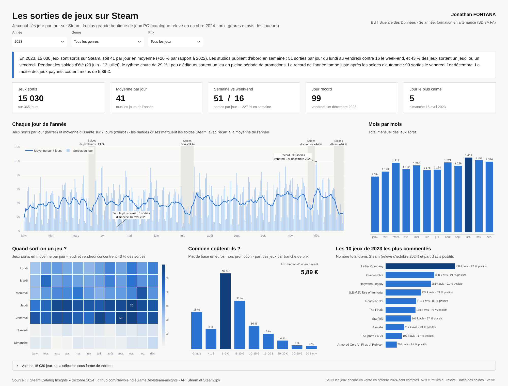

**Jonathan FONTANA** - BUT Science des Données VCOD 3A FA
Projet individuel de data visualisation - thématique « Les jeux vidéo » - outil : **Streamlit & Python**

Chaque jour, des dizaines de jeux sortent sur Steam, la plus grande boutique de jeux PC. Ce dashboard
montre **quand**, **combien** et **à quel prix** : il suit les sorties jour par jour sur une 2023, repère
les périodes creuses et les records, et met en avant les jeux qui ont le plus fait réagir les joueurs.

## Les données

- Source : [Steam Catalog Insights (octobre 2024)](https://github.com/NewbieIndieGameDev/steam-insights),
  export d'une base construite à partir de l'API Steam et de SteamSpy.
- 76 916 jeux sortis entre 2013 et 2023 (dashboard sur 2023 uniquement), avec date de sortie, prix,
  genres et nombre d'avis.
- `prepare_data.py` télécharge les tables brutes, les nettoie et les joint dans `data/steam_games.csv`.
- Dates des soldes Steam 2023 : annonces officielles de Valve.

